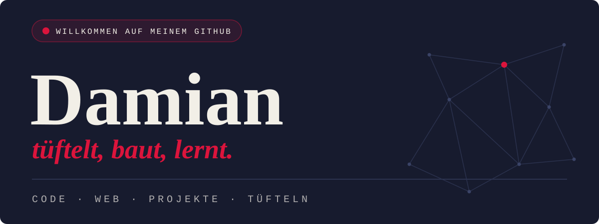
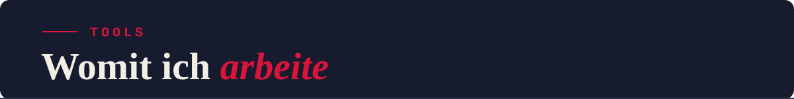
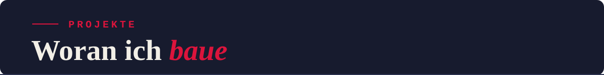

 

Hier steht ein kurzer Text über dich: Was du baust, was du gerade lernst und woran du Spass hast.
Zwei, drei Sätze reichen.

- **Aktuell:** dein aktuelles Projekt
- **Ich lerne:** dein Lernthema
- **Ziel:** was du als Nächstes erreichen willst

 

  
  
  
  
  

 

- [**Projektname**](https://github.com/abdhitwef/REPO) – eine Zeile, was es macht
- [**Projektname**](https://github.com/abdhitwef/REPO) – eine Zeile, was es macht

  
  

 

- E-Mail: **du@example.com**
- GitHub: [@abdhitwef](https://github.com/abdhitwef)
